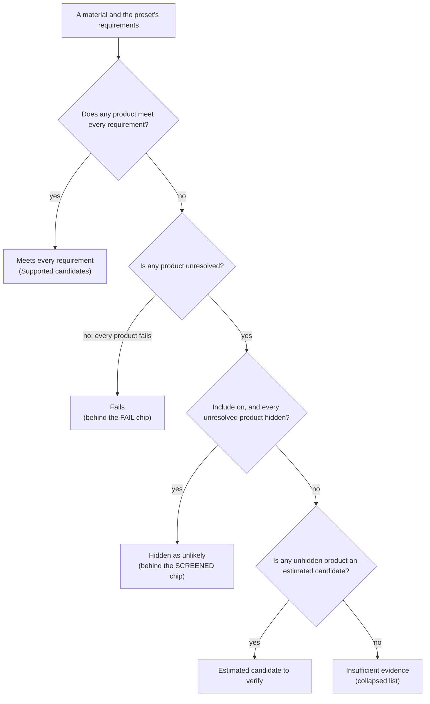

# How the selector sorts a material it could not check

> **Historical record** (2026-10-18): written for the screening review. It describes the tool as it was on release 9ca94d31fc5d; rules and file names may have changed since. For where things stand now, read the [README](../../../README.md) and [OPEN-PROBLEMS](../../OPEN-PROBLEMS.md).

> **In short.** This file explains where the selector puts each material when "Materials that could not be checked" is
> set to **Include** and "Let estimates rule out materials" is on. The tool judges every product of a material on that
> product's own data. A material passes when one product passes, and fails only when every product fails. Everything in
> between lands in one of three places: estimated candidates, insufficient evidence, or hidden as unlikely. Today no
> product estimate can hide anything. Across the six presets the tool hides a material 33 times: 30 times because a
> property does not apply to it, and 3 times on the estimate of a material that has no products. The page still says
> estimates rule materials out, which is the first of twelve problems listed at the end.

The section tags (§3, §4, §5) and the observation numbers are the ones the review's [README](README.md) cites. Every
figure was re-run on release 9ca94d31fc5d. The per-preset lists of materials are in [CENSUS.md](CENSUS.md).

A note on names. The brief called the first switch "Materials with missing data: Include uncertain". Since the
selector was refined on 2026-10-18 (decision D146), the page calls it **"Materials that could not be checked: Leave out
| Include"**. "Let estimates rule out materials" kept its name.

## The five places a material can end up

With Include on and a requirement set, every material lands in exactly one of five places.

1. **Meets every requirement** (the list "Supported candidates", the PASS chip). At least one of its products passes
   every requirement on its own published data. *Example:* ASA-CF is listed for the Outdoor structural part because 2 of
   its 17 products pass, Polymaker FIBERON ASA CF08 among them, although 3 others fail.
2. **Estimated candidate to verify.** No product passes, but one product's only open questions are numbers the tool
   estimated, and each estimate's middle value (a 50/50 guess) meets the limit. *Example:* PLA-CF in the High-stiffness
   fixture (modulus at least 5 GPa): Spectrum THE FILAMENT PLA CF publishes no qualifying modulus, and its estimate's
   middle value is 5.05 GPa.
3. **Insufficient evidence** (a collapsed list). No product passes, at least one is unresolved, and none qualifies as
   an estimated candidate. *Example:* PPS-CF in Warm environment has a median HDT of 251 °C. It sits here because the
   product that speaks for it, Bambu Lab PPS-CF, needs a 60–90 °C chamber and the H2C reaches only 65 °C. The printer
   check is undecided.
4. **Hidden as unlikely** (the page says "screened"; the SCREENED chip brings it back). No product passes, and every
   unresolved product is ruled out by inference: a property that does not apply to it, its base resin's chemical data,
   or an estimate. It is still counted as UNKNOWN, never as FAIL. *Example:* TPC in the Outdoor structural part. HDT does
   not apply to an elastomer, so all 10 of its unresolved products are hidden. Its other 2 products fail.
5. **Fails** (the FAIL chip, off by default). Every product fails at least one requirement on its own data. *Example:*
   PBT in the Indoor prototype. Its sheet asks for a 160–200 °C bed, wholly above the H2C's 120 °C.

Places 2, 3 and 4 all carry the verdict UNKNOWN. They differ only in how the list groups them, and the page shows them
only under Include. Under Leave out the page lists place 1 and only counts the rest.

### Where the page shows each place

These are the exact words on the page, so a reader can match this file to the screen.

- **The status bar** counts materials by answer: `PASS n`, `UNKNOWN n` and `FAIL n`, titled "that meet every
  requirement", "that could not be checked for missing data" and "that fail a requirement". It appears once a requirement
  is set, and each chip shows or hides its rows. Leave out shows PASS only. Include shows PASS and UNKNOWN. FAIL starts
  hidden in both.
- **The SCREENED chip**, `SCREENED n`, appears only with Include, the estimates switch on and at least one material
  hidden. Its title reads "…UNKNOWN materials are excluded: an estimate of a missing value clearly misses a requirement,
  or resin reference data reports the base polymer attacked or dissolved". It starts off. The materials it holds are
  counted inside UNKNOWN, never inside FAIL.
- **The count line** reads "N shown PASS + UNKNOWN · X candidates, Y could not be checked, Z screened out, W failed".
  Under Include, "candidates" also counts every UNKNOWN material that is not hidden.
- **Under the estimates switch** the page prints "N screened". Under Leave out it prints "Works only when the materials
  that could not be checked are included".
- **The list sections** appear only under Include with a requirement set: "Supported candidates (n)", then "Estimated
  candidates to verify (n)" with the note "Predicted centres meet the missing numerical requirements. Still UNKNOWN;
  confirm before choosing.", then a collapsed "Insufficient evidence (n) — included in counts and exports", then
  "Excluded / screened (n)". The last holds only rows the reader brought back with the FAIL or SCREENED chip. The CSV
  export is sorted in the same order.
- **Each row's result cell** shows the verdict chip. A hidden material adds a `screened` chip: "Screened by an estimate:
  …" or "Screened by the base polymer's published behaviour: …", then "Not a failure; not measured.". The cell shows the
  product share, such as "3 of 27 products" or "none judged". Hovering the share adds "None passes, but not every product
  fails, so the material is unresolved, not failed". An unresolved row adds a line such as "Estimated candidate to
  verify: 7 products fail at least one requirement; 4 remain unresolved" or "Insufficient evidence: 11 products have no
  complete qualifying evidence". The older words "likely fails" are no longer printed anywhere.
- **The drawer and the Why view** give a material's reasons: "Shown for its closest product, *X*." and then one line per
  requirement.
- **The sentence above the list** reads "Included, those N are listed flagged, except the K excluded by an estimate or by
  resin reference data; the SCREENED chip at the bottom shows them."
- **"Why the rest were excluded"** gives one line per requirement: "failed N · could not check M (K of them excluded by
  an estimate / by resin reference data) · removing it would bring back R candidates".
- **The CSV export** opens with "# materials that could not be checked: include; estimates and polymer data on (never
  pass; may screen out)". The columns `Estimated fields`, `Screened by estimate` and `Screened by base polymer` appear
  only with estimates on. `Candidate group` (supported / estimated / insufficient / excluded) is always there.

## What happens to one product?

The tool answers each requirement for each product, takes the product's worst answer, and tries the product in every
state the scenario allows.

1. **It builds the product's own view.** The view holds the product's own values and print settings. Where the
   product's sheet is silent, it reads a twin's (a product sold under another name with the same data sheet). For print
   settings and drying it can also read the printer maker's guide.
2. **It answers each requirement** with one of four answers: pass, fail, could not be checked, or straddles the limit
   (the data lies on both sides of it). The last two both count as unresolved. Requirements that are only reported, such
   as price in the Outdoor preset, never count.
3. **It combines the answers.** One fail makes the product fail. No unresolved answer makes it pass. Otherwise the
   product is unresolved, and the tool sorts it further:
   - **hidden**, if Include is on and *any one* of its unresolved answers is ruled out by inference;
   - **estimated candidate**, if *every* unresolved answer is an estimate whose middle value meets the limit;
   - **insufficient evidence**, otherwise.
4. **It tries each state the scenario permits and keeps the best.** The product is tried as printed. It is also tried
   in each annealed state its sheet publishes, when the scenario allows annealing and the oven reaches that temperature.
   Every try uses the moisture state the scenario asks for, dry by default. An annealed try must also meet one extra
   requirement: its annealing schedule must be stated in full. The best try wins, in this order: pass, estimated,
   insufficient, hidden, fail.

### How a numeric requirement is answered

The tool takes the first of these six cases that fits the product.

1. **A value measured the way the requirement asks** (a printed bar, direction stated) is compared with the limit. A
   published "mean ± band" is judged on its mean, and flagged "close to the limit" when the limit falls inside the band.
   A published range or one-sided bound is judged as itself. If it straddles the limit, the answer is unresolved.
2. **A property that does not apply** (an elastomer's HDT, a support material's mechanical values) is unresolved and
   hidden, whatever the limit. This happens only with estimates on. With estimates off, the case falls through to 6.
3. **An estimate**, with estimates on, is unresolved and never a pass. It hides the product only when all five of these
   hold:
   - the wide range (95 %) wholly misses the limit;
   - the part of the range back-testing has shown safe (the "screen range") also wholly misses it;
   - the estimate has proof from back-testing that it may exclude;
   - for a product prediction, the product's as-printed dry try has all three printer checks inside the H2C's range;
   - no measured lower bound meets the limit (a measured yield stress, for example, proves the strength is at least
     that high).
4. **A value published without its direction or test load** is unresolved, "not comparable". It decides at case 1
   only when the Data quality setting admits such values.
5. **A value published only in another state** (annealed, or conditioned) is unresolved, "other state".
6. **Nothing** is unresolved. The reason reads "Not published in the sampled sources…", or "No qualifying measurement.
   Published related values: …" when the product publishes related values.

### How the other requirements are answered

- **Printer checks** (nozzle, bed and chamber temperature). Inside the H2C's range passes. Two cases straddle the
  limit: a chamber window the H2C reaches only in part, and a setting the maker recommends, but does not require, above
  what the H2C gives. Beyond the H2C's range fails. No print profile is unresolved. A product with several profiles
  takes the best, in this order: inside, partly inside, recommended above the H2C, beyond, unknown.
- **H2C capability** fails a material recorded as beyond the H2C (more heat than it gives, or a sintering feedstock).
- **Hardened nozzle** fails a product whose sheet says it needs one, and passes one whose sheet says no concern. A
  fibre-filled product whose sheet is silent stays unresolved. Every other product passes.
- **Availability** is unresolved with no offer, and fails when the offer is out of stock.
- **Drying** passes on any statement and is unresolved when the sheet is silent.
- **A recorded attribute** (build material, family, polymer, filler) passes or fails on what is recorded, and is
  unresolved when nothing is.
- **Environment** reads the product's own records, else its twin's. A contrary record alone fails. Mixed records, or a
  positive record beside a limited or narrative one, straddle. A positive record alone passes. Anything else is
  unresolved. An "indicator" category is always unresolved. With no record in the category, the tool reads the base
  resin's data. That answer is always unresolved, and it is hidden when the resin data rules the polymer out and
  estimates are on.
- **Evidence checks** (data from the exact product, no conflicting records) pass or fail.
- **Treatment.** A product used as printed passes. An annealed state passes with a full schedule and is unresolved with
  a partial one.

## How do products' answers become the material's answer?

A material passes when one product passes and fails only when every product fails. Otherwise it takes the best place
any of its unresolved products reached, and it is hidden only when every unresolved product is hidden.



- **Failing products never decide while another product is unresolved.** A material whose products all fail or are
  hidden is hidden, not failed. The rule that a material fails only when every product fails is decision D100. The
  rule that every unresolved product must be hidden before the material is hidden is decision D137.
- **One product is enough** to make the material an estimated candidate. Observation 4 shows what that does.
- **One product speaks for the material.** It is the first passing product. Failing that, it is the first unresolved
  product that is not hidden, estimated ones first. Failing that, it is the first hidden one, then the first failing
  one. "First" means the material's own product order. The row's reasons and the drawer's "closest product" are that
  product's.
- **A hidden material lists every hidden answer.** Its reasons repeat each unresolved product's hidden answer, each
  prefixed with the product's ID. That is why TPC's chip repeats the same HDT requirement ten times.
- **A material with no products is judged on its own values and its own estimate.** Three materials are in that
  position: PA66-CF, PA612 and PA612-GF.
- **Under Leave out there are no sections.** PASS is listed. UNKNOWN and FAIL are counted and hidden. Each unresolved
  material keeps the list of requirements it could not be checked against.

## What do the two switches do? (§4)

**Include** decides whether materials that could not be checked are listed. **Let estimates rule out materials** works
only under Include, and it does more than its name says: it also creates the "Estimated candidates to verify" section.

- **Defaults.** A new scenario starts with Leave out and the estimates switch on. So pressing Include turns estimates on
  at once. The switch is greyed out under Leave out, and the tool uses estimates only when both Include and the switch
  are on. The trace and census scripts apply the same rule, so they match the page.
- **What Include changes.** Unresolved materials are listed, flagged, and the list is grouped. FAIL stays hidden. No
  verdict changes: Include changes what is listed, never whether a material passes (decision D26).
- **What the estimates switch changes, under Include only.** Three things:
  1. An unresolved answer can be an estimate, which can make a material an "Estimated candidate to verify". The
     switch's name and its help text mention only ruling out.
  2. Inference can hide materials: properties that do not apply, base-resin data, and estimates allowed to exclude.
  3. The page shows estimate cells, estimate cards and the three estimate columns of the export.
- **Leave out with the switch on** behaves on the page exactly like Leave out. Called directly with those two settings,
  the engine still marks estimated groups but hides nothing, and the candidates are the same.

The table counts the materials listed as candidates in each preset under the three settings. With estimates off, every
unresolved material is listed. Turning estimates on moves some into the estimated section and hides a few.

| Preset | Leave out | Include, estimates off | Include, estimates on: supported / estimated / insufficient | Hidden |
|---|---:|---:|---|---:|
| Outdoor structural part | 7 | 108 | 7 / 6 / 81 | 14 |
| Indoor prototype | 87 | 126 | 87 / 0 / 39 | 0 |
| Lightweight structure | 15 | 97 | 15 / 18 / 64 | 0 |
| Warm environment | 39 | 123 | 39 / 0 / 68 | 16 |
| High-stiffness fixture | 5 | 109 | 5 / 9 / 94 | 1 |
| Flexible component | 8 | 110 | 8 / 10 / 90 | 2 |

## What can estimates hide today? (§3)

Only two kinds of inference hide anything today: a property that does not apply, and the estimates of the three
materials with no products. Base-resin data would hide materials too, but no preset asks about the environment. No
product estimate can hide anything.

### Where the inferences come from

- **Material estimates** (decision D43). The build estimates a material's value only for a property none of its
  products publishes in a comparable way. Each estimate has a range shown on the page (80 %) and a wide range (95 %).
  Back-testing decides, one end at a time, which part of the range may be used to exclude (decisions D48 and D59). An
  end may exclude where its kind of evidence passed the back-test at a tolerance limit. Otherwise it may exclude only
  where the family model's end agrees. It never excludes against the material's own measurements. An estimate may
  exclude when either end is set, and otherwise records why not. **These estimates reach a verdict only for a material
  with no products.** For every other material the tool reads the product predictions instead.
- **Product predictions** (decisions D81 and D137). Every product without a comparable value of its own carries its own
  prediction, used only in the as-printed, dry state. It may exclude only with proof from back-testing. The total risk
  budget of 10 % at 90 % confidence is split over five properties, which leaves 2 % at 98 % confidence for each. That
  needs 194 back-tested cases per kind of evidence, and none has that many (TPC's drawer, for one, quotes 25). So no
  product prediction may exclude. Heat deflection has no product predictions at all, because its product-level
  calibration hit its limit.
- **Old snapshots only.** The material estimate would be handed to a product only in snapshots older than version 2 of
  the estimates. The build stamps every product version 2, so that never happens here.
- **Not applicable** (decision D56). A property the headline's definition says does not apply: HDT for elastomers, and
  any value of a support material that publishes nothing of its own. A material's "not applicable" passes to every one
  of its products.
- **Implied lower bounds**, which veto a hide (decision D48). A measured value can prove a minimum: a yield or break
  stress bounds tensile strength, a yield strain bounds elongation, and HDT at 1.8 MPa bounds HDT at 0.45 MPa. If such a
  bound meets the limit, no estimate may hide the material.
- **Base-resin data** (decision D64). Published records of how the base polymer behaves (chemicals, flammability,
  hydrolysis, UV). A record is attached only where the material has no record of its own in that category.

### What the build holds today

These counts cover the 135 materials in scope (no family entries, none excluded). "Missing" means no product publishes
a value measured the way the requirement asks.

| Property | Materials missing a value | Material estimates | …that may exclude | Not applicable |
|---|---:|---:|---:|---|
| Density | 5 | 5 | 5 | 0 |
| Tensile modulus XY | 47 | 38 | 35 | 4 (supports) |
| Tensile strength XY | 41 | 32 | 32 | 4 |
| Elongation XY | 44 | 35 | 33 | 4 |
| HDT 0.45 MPa | 49 | 28 | 27 | 19 (elastomers, supports) |

Product predictions are counted on active products. The last column is a back-test of one requirement at a time. The
2026-10-08 fix computed it as a diagnostic and does not use it.

| Property | Product predictions | …that may exclude | One-requirement back-test (not used) |
|---|---:|---:|---|
| Density | 94 | 0 | this-material class passes: 6 of 110 wrong, at most 9.4 % |
| Tensile modulus XY | 698 | 0 | this-grade class passes: 0 of 41 wrong, at most 5.5 % |
| Tensile strength XY | 602 | 0 | this-grade class passes: 0 of 55 wrong, at most 4.1 % |
| Elongation XY | 648 | 0 | none |
| HDT 0.45 MPa | 0 (calibration at its limit) | – | – |

- **117 estimates that may exclude are never read.** Of the 132 material estimates that may exclude, 117 belong to
  materials that have products. The other 15 belong to PA66-CF, PA612 and PA612-GF.
- **Implied bounds veto nothing now.** They sit on 32 strength, 34 elongation and 12 HDT material values, and on 865 of
  the 2,042 product predictions. No estimate gets far enough to need a veto.
- **Resin data would hide materials only if a preset asked about the environment.** Of the 314 base-resin records, 68
  rule their polymer out, across 45 materials. By category: solvents 18, acids 14, alkalis 13, flammability 11,
  hydrolysis 10, UV 1 and water solubility 1. Moisture and oil have none.
- **A test pins this state.** It asserts "no complete-scenario class meets the reserved risk gate in this release".

### What actually hides materials in the six presets

Across the six presets (Include, estimates on), the tool hides a material 33 times, as CENSUS.md also shows. The
elastomers are hidden in both HDT presets, so they count twice.

- **Outdoor structural part: 14**, all because HDT does not apply to them (13 elastomers and OBC).
- **Warm environment: 16**, all because HDT does not apply.
- **High-stiffness fixture: 1**, PA612, on its material estimate. It has no products.
- **Flexible component: 2**, PA66-CF and PA612-GF, on their material estimates.
- **Indoor prototype and Lightweight structure: none.**

So 30 hides are properties that do not apply, and 3 are estimates of materials with no products. None comes from a
product prediction. None comes from resin data, because no preset asks about the environment. A single environment
requirement does hide materials: "Resists organic solvents" alone hides 18 on resin data.

## What is wrong or misleading (§5)

Each of these twelve was checked in the code or the data. They describe what happens; the README proposes the changes.

### The page promises estimate exclusions that no longer happen (observation 1)

The page and the build still say a material estimate can rule a material out. The switch's help text, the drawer's
estimate card ("It can exclude this material from …") and its group note say so. So do the table legend, the export's
"can screen" and the build's screening snapshot ("Screens yes"). For a material with products, that estimate is never
read, because the product predictions replaced it. So 117 estimates marked "may exclude" decide nothing. In the six
presets, 55 pairs of material and preset keep a material whose own estimate wholly misses a requirement, may exclude,
and has no veto.

*Example:* ASA-EC and ASA-AF at 5 GPa were the [2026-10-07 audit](../2026-10-07-uncertain-logic/README.md)'s hidden
examples. They are now "Insufficient evidence".

The decision records do not say this. Decision D137 and OPEN-PROBLEMS §35 say "all *new* numerical exclusions are
disabled". Neither says the older material-estimate exclusions (decisions D48 and D59) stopped too. Decision D138, which
froze the estimate stage on 2026-10-15, still credits it with hiding "32 of 673 template candidates". Today's 33 hides
are 30 properties that do not apply and 3 estimates of materials with no products.

### The test that guards exclusion checks a path the page does not run (observation 2)

The test "no material stays a candidate for a requirement its defended range fails" builds its materials without their
products. So it checks the material-level path, not the product path the page uses. AGENTS.md names this test as that
guarantee. On the page's path, the 55 pairs of observation 1 break it.

### Listing a material as an estimated candidate takes far less proof than hiding it (observation 3)

To list a material as an estimated candidate, the tool compares only the estimate's middle value with the limit. It
needs no proof from back-testing. To hide a material, it needs the wide range (95 %), the back-tested range and that
proof. In 24 of the 43 estimated rows across the presets, the product that speaks for the material has a wide range
that still crosses the limit.

*Example:* PLA-CF at 5 GPa is a coin flip. Its middle value is 5.05 GPa and its wide range 2.53 to 10.1 GPa.

Decision D137 chose to group on the middle value. The only place the page says so is the section's note ("Predicted
centres meet…"). The row's reason never states the middle value.

### One product makes the whole material an estimated candidate (observation 4)

A material is an estimated candidate when any one of its products is. In 24 of the 43 such rows exactly one product
is, and 29 of the 43 have failing products.

*Example:* PLA in the Outdoor structural part has 96 failing products, 98 with insufficient evidence and 1 estimated.
That one is colorFabb PLA-HP, which publishes no density.

On such a row the label and the reasons are that one product's, but the value columns show the spread of every product.
The estimate cell shows the *material* estimate, which decides nothing, while the reason quotes the *product*
prediction. For ASA-EC's modulus the cell's wide range is 1.93 to 4.3 GPa and the reason's is 1.83 to 4.52 GPa. That
breaks the rule of one computation per fact (decision D147).

### A property that does not apply is reported as "Screened by an estimate" (observation 5)

Every hide that does not come from resin data is filed as "Screened by an estimate". That holds in the row's chip, in
"Why the rest were excluded", in the sentence above the list and in the export column. Yet 30 of the 33 hides in the
presets are a property that does not apply by definition (decision D56). The not-applicable rule also works only with
estimates on. With estimates off, the same property reads "Not published in the sampled sources; ask the maker or test a
printed coupon".

*Example:* PEBA's HDT is filed under "Screened by an estimate", although its own reason reads "Not applicable: HDT is a
rigid-bar test…". With estimates off, the same HDT reads "Not published in the sampled sources…".

### A hidden row is labelled "Insufficient evidence" (observation 6)

The line under a row checks only whether the material is an estimated candidate. So a hidden row in "Excluded /
screened" reads "Insufficient evidence" beside its SCREENED chip. The same line prints "1 products fail".

### "Why the rest were excluded" can count a hide the material does not have (observation 7)

For each requirement, the count looks at one product only: the first that passes it, else the first that does not fail
it. It counts the material as hidden when that product's answer is hidden. The material itself is hidden only when
every unresolved product is. This cannot show today, because every live hide applies to the whole material.

### "Its closest product" is just the first one in the list (observation 8)

"Shown for its closest product" names the first product of the best place, in the material's own product order. For a
material that fails, it is the first failing product. Nothing measures closeness.

### "Screened" means two things (observation 9)

On the list, "screened" means hidden by inference (the SCREENED chip). In GOALS step 2, and in the chart's "nothing is
screened until a requirement is asked", it means checking materials against the requirements at all.

### The switch's old names live on (observation 10)

The page has said "Leave out | Include" since decision D146. Decisions D100 and D137, OPEN-PROBLEMS §35 and the export's
internal values still say "Include uncertain", "Confirmed only" or code names (supported / estimated / insufficient /
excluded). The export's `Candidate group` is also filled under Leave out. There it reads "insufficient" for an
unresolved material that is not a candidate at all.

### Code comments describe the old rules (observation 11)

The estimate stage's opening comment says the material estimate "stands in for each of the material's products" and
that product estimates "decide nothing". The comment above the estimate rule in the engine describes material-estimate
exclusion as live. Both are out of date.

### A product prediction's reason runs two clauses together (observation 12)

The reason reads "…without a calibrated bound Published related values: …; no qualifying measurement." It has no full
stop between the clauses, and it repeats "no qualifying measurement".

## What the earlier audits still get right

Most of what the two earlier audits found still holds, but some of their figures and causes have moved.

- **From the [2026-10-07 audit](../2026-10-07-uncertain-logic/README.md).** ASA-GF is still UNKNOWN at 5 GPa: 2 of its
  products fail and 4 are unresolved. A material fails only when every product fails (decision D100). The material
  estimate still exists only where no product publishes. The causes have changed. Since decision D137 each silent
  product carries its own prediction, so it no longer reads "Not published" when it publishes related values. None of
  those predictions may exclude. So the audit's "inconsistency" is gone by levelling down: ASA-EC, ASA-AF and TPU harder
  than 95A are no longer hidden either. The words "publish none" and "likely fails" are gone from the page.
- **From the [2026-10-08 fix](../2026-10-08-product-screening/README.md).** Every proof for whole scenarios is still
  disabled: 194 back-tested cases are needed, and no product prediction may exclude. HDT's product-level calibration
  still stops product predictions. The grouping into supported, estimated and insufficient is as built. Its
  one-requirement back-tests have moved with the data. Modulus now passes (0 of 41 wrong, at most 5.5 %, where the audit
  had 13.08 %), and strength is 0 of 55 (at most 4.1 %). Its scenario counts, for example "20 supported, 11 estimated,
  94 insufficient" at 5 GPa, describe that baseline. Today's High-stiffness preset is 5 / 9 / 94.

## Glossary

- **Comparable value**: a value measured the way the requirement asks (a printed bar, direction and load stated).
- **Unresolved**: could not be checked, or straddles the limit. The page shows it as UNKNOWN.
- **Hidden as unlikely**: held out of the list by inference, not by a measured failure. The page calls it "screened".
- **Middle value**: the estimate's 50/50 guess. The page calls it the "centre".
- **Range shown on the page (80 %)** and **wide range (95 %)**: the two ranges every estimate carries. The page calls
  them "likely" and "plausible".
- **Screen range**: the part of an estimate's range that back-testing has shown safe to exclude on, set one end at a time.
- **May exclude**: the estimate has proof from back-testing that it is safe to use for exclusion (`canScreen` in the
  data).
- **Material estimate** and **product prediction**: an estimate of a material's value, and an estimate of one product's
  value. Only the second is read for a material that has products.
- **Printer check**: whether the H2C can reach a product's nozzle, bed and chamber temperatures.
- **Twin**: a product sold under another name with the same data sheet.

## Evidence and where to check

File and line references are to release 9ca94d31fc5d. Decisions are in [DECISIONS.md](../../DECISIONS.md). The
per-preset figures come from [census.mjs](census.mjs), written to [CENSUS.md](CENSUS.md).

### Names and stored keys

- The first switch's labels: `app/js/ui/labels.js:27`, `app/js/ui/labels.js:33`, `app/index.html:44`. The estimates
  switch: `app/index.html:56`.
- The stored keys did not change: `scenario.unknownPolicy` is `'strict'` (Leave out) or `'exploration'` (Include),
  beside `scenario.useEstimates`.

### The five places, and where the page shows them

- Examples, from [CENSUS.md](CENSUS.md):
  - Outdoor: M033 ASA-CF, 2 products pass, 3 fail, 12 open, shown for G033-11 Polymaker FIBERON ASA CF08.
  - High-stiffness: M018 PLA-CF, shown for G018-02 Spectrum THE FILAMENT PLA CF, estimated 3.4 to 7.48 GPa, middle
    value 5.05, wide range 2.53 to 10.1.
  - Warm environment: M073 PPS-CF, shown for G073-01 Bambu Lab PPS-CF, "Needs 60–90 °C; the H2C reaches only up to
    65 °C, part of that window".
  - Outdoor: M046 TPC / TPEE, 2 products fail and 10 are hidden.
  - High-stiffness: M058 PA612, no products, hidden on its estimate (1.22 to 3.37 GPa, wide range 0.915 to 4.51).
  - Indoor: M140 PBT (G140-01, profiles P1447, P1458, P1468), from
    [presets/flexible-and-indoor.md](presets/flexible-and-indoor.md).
- Status chips: `app/js/main.js:600-613`, `app/index.html:110-112`. Their defaults: `app/js/main.js:35-36`.
- SCREENED chip: `app/js/main.js:632-638`, `app/index.html:113`. When it appears: `app/js/main.js:541-542`. Off by
  default: `app/js/main.js:52`. Counted in UNKNOWN, never FAIL: `app/js/engine/constraints.js:752-758`.
- Count line: `app/js/main.js:550-588`.
- Under the switch: `app/js/main.js:618-628`, `app/index.html:62`.
- List sections: `app/js/ui/table.js:550-561`. The export's sort by group: `app/js/ui/table.js:149-154`.
- Result cell: `app/js/ui/table.js:333`, `app/js/ui/labels.js:231-258`, `app/js/ui/table.js:183-200`,
  `app/js/ui/table.js:248-254`. The share's hover text is decision D100. "likely fails" survives only in a comment,
  `app/js/ui/table.js:246`.
- Reasons in the drawer and Why: `app/js/ui/explain.js:101-150`.
- Sentence above the list: `app/js/ui/start.js:123-128`.
- "Why the rest were excluded": `app/js/ui/start.js:157`, `app/js/ui/explain.js:21-26`, `app/js/ui/explain.js:58`. Its
  counts come from `explainExclusions`, `app/js/engine/constraints.js:767-795`.
- CSV export: `app/js/ui/table.js:628-711`. Products export: `app/js/ui/table.js:744`, `:768`.

### One product's path

All in `app/js/engine/constraints.js` unless named otherwise.

- One requirement, one product: `evaluateConstraint`, `:582`.
- The product's view: `productView`, `app/js/engine/products.js:230`. A value decides when comparable, or when Data
  quality admits values published without direction or load: `products.js:151` (D84). A material's "not applicable"
  passes to every product: `products.js:148`. A product prediction is attached only as printed and dry:
  `products.js:169-171`. The material estimate is used only for snapshots before version 2: `products.js:172-175`. The
  build stamps every grade `estimateVersion = 2`: `build/src/estimate/index.js:210`.
- Numeric requirements, `evaluateNumeric`, `:124-251`. The six cases in order:
  1. A value that decides: `:207-250`, `compareInterval` `:92-120` (D54, D84).
  2. Not applicable, estimates on: `:132-137` (D43, D56).
  3. An estimate, estimates on: `:145-184`. The wide range `:148`, the screen range `:151-152`, the veto and the
     permission `:157-159` (D26, D43, D48, D59, D137). A material estimate always has permission. A product prediction
     needs `completeProductContext`.
  4. Published without direction or load: `:186-192` (D84).
  5. Published only in another state: `:194-196` (D99).
  6. Nothing: `:197-204` (D26).
- Printer checks, `evaluateGate`, `:304-402`. The mapping `GATE_STATUS`, `:30-36`: `within` is PASS, `partial`
  (chamber, D32) and `exceeds-recommended` (D6) are INDETERMINATE, `exceeds` is FAIL, `unknown` or no profile is UNKNOWN
  (`products.js:185`, `:195`). Several profiles combine in the order within > partial > exceeds-recommended > exceeds >
  unknown: `build/src/gates.js:18-43`. H2C capability (scope): `:305-316`. Hardened nozzle: `:338-358` (D27, D121).
  Availability: `:365-385` (D98). Drying: `:387-396` (D127).
- Recorded attributes (facets): `:406-426`.
- Environment: `:436-510` (D98, D89, D28). Indicator categories: `:442-449`. Base-resin fallback: `:466-467`, and
  `evaluatePolymerLevel`, `:530-540` (D64).
- Evidence checks: `:548-580`.
- Treatment: `:281-288` (D99).
- One product, one state, `evaluateMaterial`, `:598-643`:

  ```text
  failed     = required results that FAIL                                   (reported ones never count)
  unresolved = required results that are UNKNOWN or INDETERMINATE
  verdict    = FAIL if any failed, else PASS if nothing unresolved, else UNKNOWN              (D26)
  screened   = Include  and  verdict UNKNOWN  and  ANY unresolved result is screened          (:614)
  estimatedCandidate = unresolved non-empty and EVERY unresolved result is an estimate,
                       not screened, whose CENTRE meets the limit                             (:615-616, D137)
  group      = PASS → supported; UNKNOWN and not screened → estimated | insufficient; else excluded  (:617-618)
  eligible   = PASS, or (Include and UNKNOWN and not screened)                                (:624)
  ```

- Each permitted state, `judgeProduct`, `:650-666`. The states come from `scenarioStates`, `products.js:48-55`: as
  printed first, annealed only when allowed and within the oven's reach, in the moisture state asked for. An empty state
  stands in where the product publishes none. `completeProductContext` is true only for the untreated dry try when all
  three print gates are `within`: `:658-659` (D137). Best try: `:662-664`.

### How products' answers become the material's answer

- `evaluateProducts`, `:681-714`:

  ```text
  verdict  = PASS if any product passes; UNKNOWN if none passes and any is UNKNOWN (someFail when some fail);
             FAIL only if every product fails                                                  (:688, D100)
  share    = all | some | none, null when nothing could be judged                              (:689, D83)
  screened = Include and UNKNOWN and EVERY unknown product is screened; failing products are ignored  (:691, D137)
  best     = first PASS, else first unscreened 'estimated', else first unscreened UNKNOWN,
             else first UNKNOWN, else first FAIL, in the material's product order              (:692)
  row      = best product's results, failed, unresolved, shortlistGroup, gradeId and state,
             plus the material's verdict, eligibility, screened and counts                    (:693-713)
  ```

- A hidden material's reasons, prefixed with each product's ID: `:701`. Leave out's list of requirements (`heldBy`):
  `:702`.
- A material with no product is judged on its own headline: `:682`. In this release: M056 PA66-CF, M058 PA612, M060
  PA612-GF.

### The two switches

- Defaults: `app/js/engine/scenario.js:34`, `:44`; `app/js/main.js:46`.
- The engine reads `ctx.useEstimates = Include && switch`: `app/js/main.js:177`. Disabled under Leave out:
  `app/js/main.js:621`. The trace applies the same rule: `scripts/trace.mjs:49` (`pageContext`).
- Include never changes a verdict: D26.
- The switch's help text: `app/index.html:59`. Display of estimates (`showEstimates`): `app/js/main.js:184`.
- Leave out with estimates on, called directly: `app/js/engine/constraints.js:614`.

### What can estimates hide today

- Material estimates: `build/src/estimate/index.js:116-185` (D43). Only where no product publishes comparably: `:118`.
  The screen range, end by end: `build/src/estimate/screening.js:78-143` (D48, D59). Never against the material's own
  evidence: `screening.js:126-133`. `canScreen` is true when either end is set, and `screenLimit` says why an end is not.
- Product predictions: `build/src/estimate/grades.js:94-147` (D81) and `build/src/estimate/product-screening.js:81-160`
  (D137). Attached to every product without a comparable value: `grades.js:140`. The 10 % / 90 % budget split into 2 %
  at 98 %: `product-screening.js:105-107`. `screenRange` and `canScreen` set only when proven: `:150-155`. HDT's grade
  calibration at its clamp: `build/src/estimate/index.js:105-109`.
- Not applicable (D56): the headline definition's "Applies to" (elastomers' HDT), and supports with nothing of their own,
  `build/src/estimate/index.js:130-132`.
- Implied lower bounds (D48 veto): `headline_definitions.csv`, column Lower bound.
- Base-resin data (D64): `db.polymerEvidence`.
- All counts are on `dist/db.json`, release 9ca94d31fc5d. "In scope" means not a family entry and not excluded.
- The test that pins the state: `test/product-screening.test.js:106`.

### Observations

1. Help text `app/index.html:59`. Drawer estimate card `app/js/ui/detail.js:384-386` and group note
   `app/js/ui/detail.js:411`. Table legend `app/js/ui/table.js:462`. Export "can screen" `app/js/ui/table.js:669`.
   `build/snapshot/screening.csv` ("Screens yes"). The version stamp `build/src/estimate/index.js:210` means
   `app/js/engine/products.js:172` never hands the material estimate to a product. D137, OPEN-PROBLEMS §35, D138.
2. `test/screening.test.js:85-116` builds its context without `productsByMaterial`, so it runs `evaluateMaterial` on
   the material headline (`app/js/engine/constraints.js:740-744`).
3. Grouping on the middle value: `constraints.js:615-616`. Hiding: `constraints.js:159`. The row's reason:
   `constraints.js:160-168`.
4. One product names the material: `constraints.js:692`. The row takes that product's results: `constraints.js:693`.
5. `screenedByKind` files every non-resin hide under estimates: `app/js/ui/labels.js:231-237`. Also
   `app/js/ui/explain.js:21-26`, `app/js/ui/start.js:126-127` and the export column. Not applicable needs
   `useEstimates`: `constraints.js:132`, else `:197-204`.
6. `unknownMark` checks only for 'estimated': `app/js/ui/table.js:251`. "1 products fail": `:252`.
7. `explainExclusions` takes the first passing, else first non-failing product: `constraints.js:784`. It counts that
   product's hide: `:787`. The material's own rule: `:691`.
8. "Shown for its closest product": `app/js/ui/explain.js:129`, from `constraints.js:692`.
9. `app/js/ui/decision.js:107`, `:393`, `:880`.
10. Export values: `app/js/ui/table.js:707`.
11. `build/src/estimate/index.js:9-10`; `app/js/engine/constraints.js:138-144`.
12. `constraints.js:167`, `:171`, `:181`.

### Decisions cited

- D6: a recommendation is not a requirement. D26: the verdict describes the evidence, the setting decides what is
  listed. D27: the nozzle question asks what the user lacks. D28: limited resistance is not resistance. D32: a chamber
  the printer only partly reaches is partial.
- D43: an estimate is a calibrated model and says how far to trust it. D48: evidence hides only where a back-test shows
  it hides reliably. D54: a mean ± band is judged on its mean. D56: what an elastomer cannot have. D59: one end of a
  range at a time, never against the material's own evidence. D64: base-resin behaviour may hide, never passes.
- D81: every product has its own estimate. D83: a material is the spread of its products. D84: values without
  direction or load are counted apart. D89: a twin reads its sibling's values. D98: a product's verdict rests on its own
  records. D99: a product is judged in a state it can be made in. D100: a material fails only when every product fails.
- D121: fibre and brass nozzles. D127: drying as the sheet states it. D137: product predictions may not exclude without
  separate proof. D138: the estimate stage is frozen. D146: the selector refined. D147: one computation per fact.
